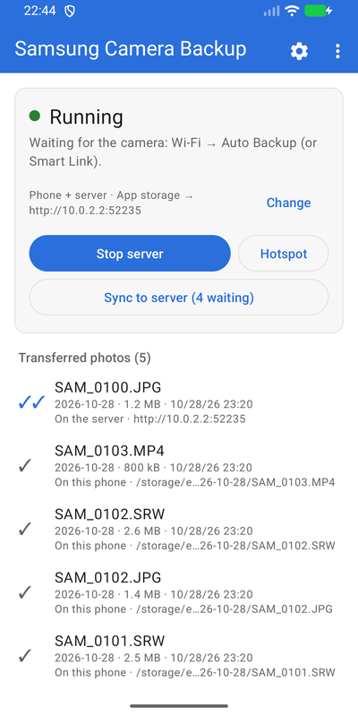
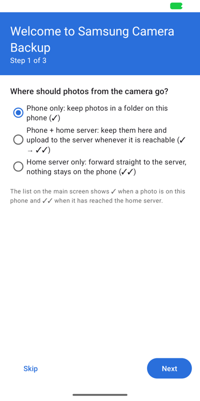
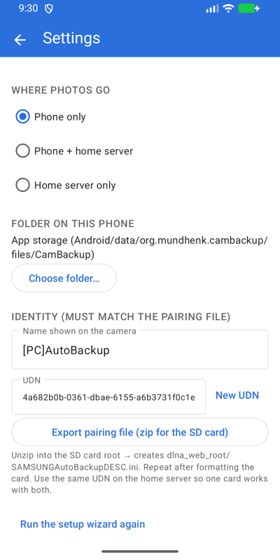
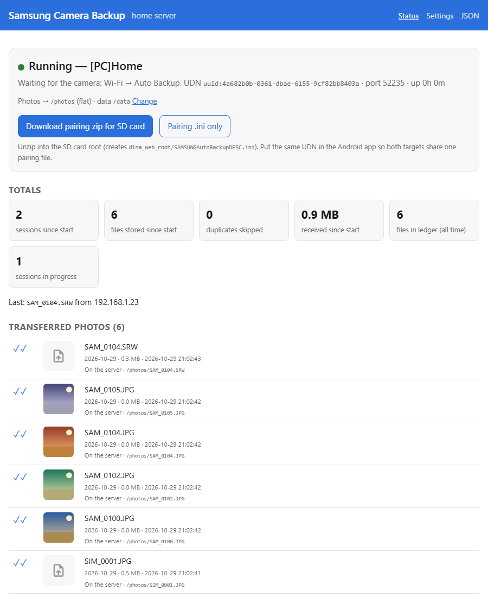

# Samsung Camera Backup

Get the photos and videos off your Samsung Wi-Fi camera again. The camera's built-in
*Auto Backup* pushes every new file over Wi-Fi to a "PC" of your choice: this project is that
PC, as an **Android app** for the road and as a **home server** (Docker) for your network.
Samsung's own software is gone; the camera still works.

> Samsung Camera Backup is an independent open-source project. It has no relation to Samsung
> Electronics and is neither endorsed nor supported by them. "Samsung" and the camera model
> names only say which cameras it works with.

**Cameras:** the 2012–2015 Wi-Fi models with *Auto Backup* in the Wi-Fi menu: NX1000, NX1100,
NX2000, NX300, NX3000, WB150F/WB250F/WB850F, ST200F, DV300F and friends. Developed against the
NX1000.

## App or server?

| | Android app | Home server |
|---|---|---|
| Where | the phone, anywhere (hotspot) or at home | always-on box on your LAN (NAS, Proxmox, Raspberry Pi) |
| Photos end up | in a folder on the phone, on the server, or both | in the server's folder, then optionally renamed, time-shifted, RAW-previewed and moved into a share |
| Best for | shooting away from home | everything at home, automation (Home Assistant), big RAW archives |

Use both: the app collects on the road, then syncs to the server when you are back home.
One pairing file on the SD card serves both.

## Getting started with the app

1. Install the APK from the [releases page](https://github.com/PhilippMundhenk/SamsungCameraServer/releases).
2. The first start runs a short wizard: where photos should go, the folder or server, and the
   name the camera will show.
3. **Export pairing file** (wizard or Settings) and unzip the file into the root of the camera's
   SD card.
4. Tap **Start server**. On the camera: Wi-Fi → *Auto Backup*, connect to the phone's hotspot
   or the same Wi-Fi. The camera uploads everything it has not backed up yet.
5. Watch the list: ✓ = on the phone, ✓✓ = on the home server.

Details, modes and tips: [docs/APP.md](docs/APP.md).

## Getting started with the home server

```yaml
# docker-compose.yml
services:
  cambackup:
    image: ghcr.io/philippmundhenk/cambackup-server:latest
    network_mode: host          # the camera finds the server by multicast
    restart: unless-stopped
    volumes:
      - ./data:/data            # config, pairing file, ledger (small)
      - ./photos:/photos        # received photos and videos (large)
    environment:
      CAMBACKUP_SERVER_NAME: "[PC]Home"
      CAMBACKUP_API_TOKEN: change-me   # the token the app uses
```

```sh
docker compose up -d
```

Open `http://<host>:52235/`, download the **pairing zip**, unzip it into the SD card root.
On the camera: Wi-Fi → *Auto Backup*. Every option (time shift, RAW previews, renaming,
export into a Synology Drive share, webhooks) is explained in [docs/SERVER.md](docs/SERVER.md).

## Screenshots

| App: main screen | App: setup wizard | App: settings |
|---|---|---|
|  |  |  |



## Documentation

* [docs/APP.md](docs/APP.md) — the Android app: modes, pairing, daily use
* [docs/SERVER.md](docs/SERVER.md) — the home server: options, pipeline, networking, API
* [docs/PROTOCOL.md](docs/PROTOCOL.md) — what the camera does (reverse engineered)
* [docs/DEVELOPMENT.md](docs/DEVELOPMENT.md) — building, tests and coverage, CI, releases, known gaps
* [docs/DESIGN.md](docs/DESIGN.md) — design notes and decisions, [docs/BRANDING.md](docs/BRANDING.md) — look and feel

Status: complete against a simulated camera; the first run against a real camera is
[issue #6](https://github.com/PhilippMundhenk/SamsungCameraServer/issues/6). Questions and
problems: [GitHub issues](https://github.com/PhilippMundhenk/SamsungCameraServer/issues).
