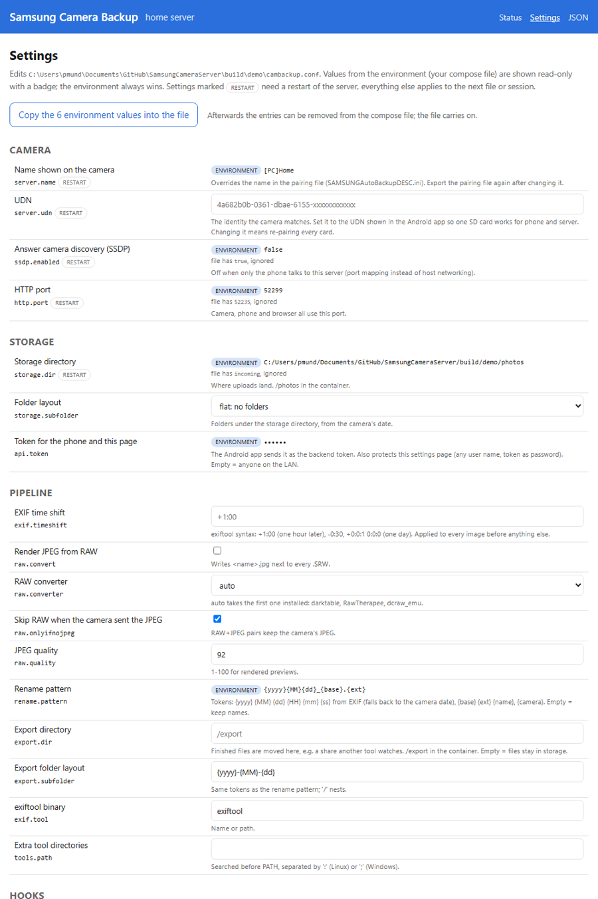

# Screenshots

Taken on an Android emulator (API 37) and against a local home server fed by the camera
simulator; the file names are the simulator's.

## App: main screen

The status card shows whether the server runs, where photos go and the one action that
matters; **Hotspot** next to it opens the phone's hotspot settings for use on the road. Below
it every transferred file with a preview: ✓ on this phone, ✓✓ on the home server; a tap opens
the file. Here the last session is still waiting for the home server, which the app keeps
trying on its own ("automatic").

## App: setup wizard

Three steps on first start: where photos go, folder or server, pairing file.

## App: settings

Everything from the wizard, plus the identity the camera is paired with. Locked while the
server runs.

## Home server status page

The same status card as the app, totals, the transferred files (all ✓✓ by definition), the
cameras and phones that have talked to the server (each can be given a name), tool availability
and the log; the pairing zip is one click away.

## Home server settings page

Every option of `cambackup.conf` with an explanation. Values from the compose file carry an
`environment` badge and are read-only; "restart" marks what needs a restart.

